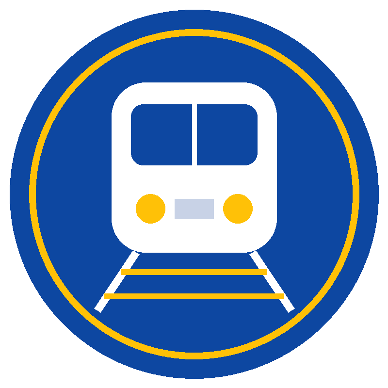
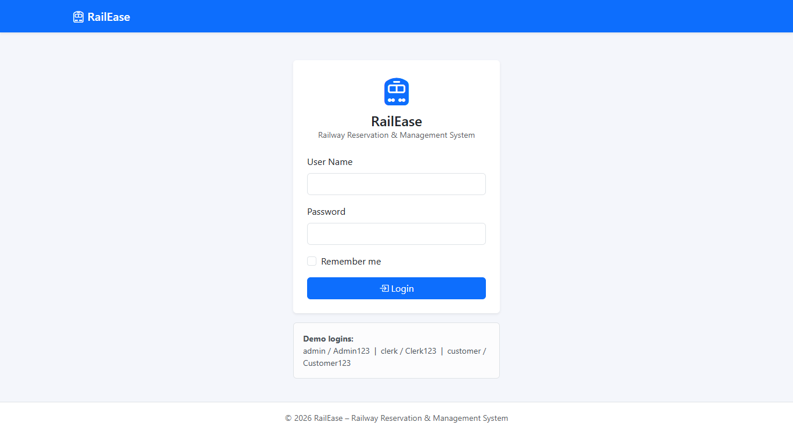
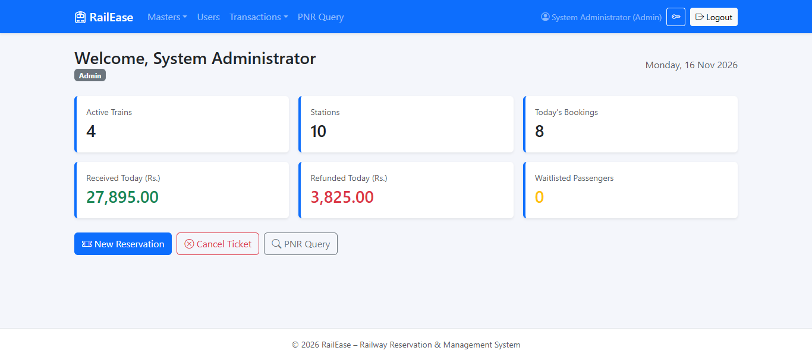
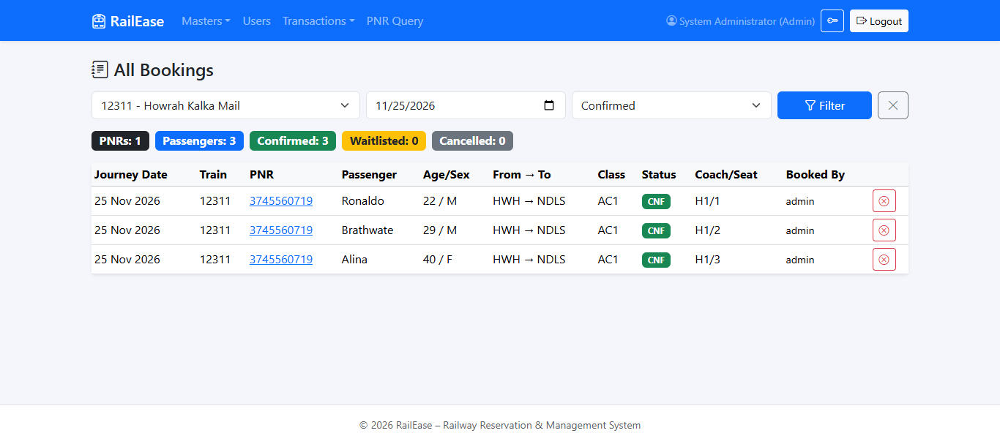
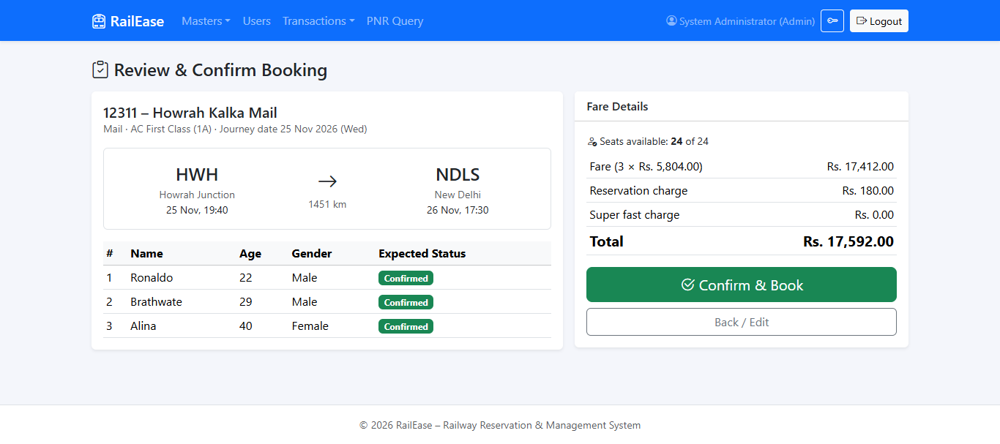
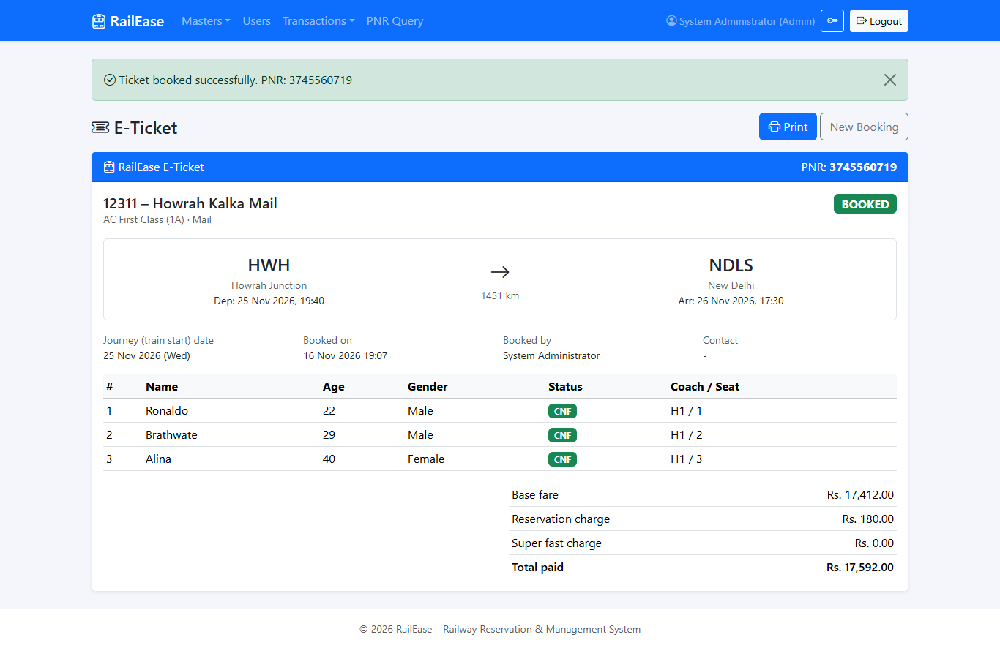
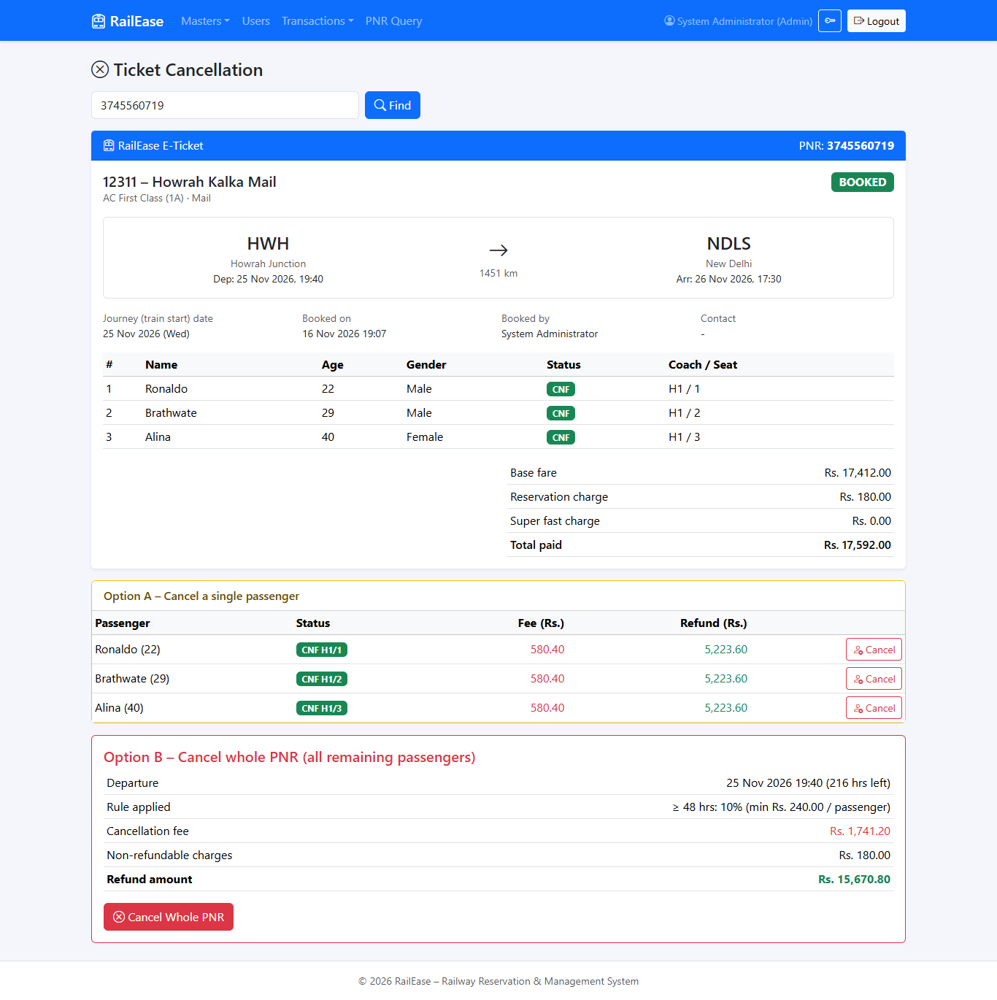

<p align="center">
  
</p>

<h1 align="center">RailEase – Railway Reservation & Management System</h1>

<p align="center">
  A complete web application for online train reservation, cancellation, waitlist management and daily cash reporting.
</p>

<p align="center">
  
  
  
  
  
  
</p>

---

## 📖 Overview

**RailEase** automates the complete railway reservation life-cycle. Users select a train, journey date, stations, class and passengers; the system validates the request, calculates the fare, allocates **coach and seat numbers** (or a **waitlist number**) and generates a unique **PNR** with a printable e-ticket.

Staff manage all master data, cancel tickets (whole PNR **or a single passenger**), allocate freed seats to waitlisted passengers and review daily cash with **export to Excel**.

> Built as an academic eProject with production-style practices: layered architecture, role-based security, hashed passwords, server- and client-side validation, and transactional seat allocation.

---

## ✨ Features

### 🔐 Security
- Role-based access: **Admin**, **Clerk** and **Customer**
- Passwords hashed with **PBKDF2 (HMAC-SHA256, 100,000 iterations, random salt)**
- System-generated default password with **forced change at first login**
- **Account lockout** after 5 failed logins (15 minutes)
- CSRF protection, over-posting protection, open-redirect protection, HttpOnly/SameSite cookies

### 🗂️ Master Management (Admin)
- Station Master (system-generated Station ID, code, name, division)
- Train Master (train no, name, Up/Down, type, route, coaches per class)
- Train Schedule (stops, arrival/departure, distance, day offset)
- Day Master (running days of each train)
- Fare Rules (distance slabs per class), Cancellation Rules, Reservation & Super Fast Fees
- User Management

### 🎫 Transactions
- **Reservation** – validates date (after today, within 90 days), running day, route and class; up to 6 passengers per PNR; review & confirmation page before saving
- **Segment-aware seat allocation** – a seat can be resold for a later part of the route
- **Cancellation** – whole PNR or individual passenger, automatic fee and refund calculation
- **Waitlist allocation** – freed seats are automatically given to waitlisted passengers
- **Daily Cash Transactions** – received, refunded and net amount, **export to Excel (CSV)**

### 🔎 Query & Reports
- PNR enquiry with current coach/seat/waitlist status
- All Bookings screen with Train, Date and Status filters
- My Bookings and printable e-ticket

---

## 🛠️ Tech Stack

| Layer | Technology |
|---|---|
| Framework | ASP.NET MVC 5, .NET Framework 4.8 |
| Language | C# |
| ORM | Entity Framework 6.4 (Code First) |
| Database | Microsoft SQL Server / LocalDB |
| Front-end | Razor, Bootstrap 5.3, Bootstrap Icons, jQuery Validation, Fetch API |
| Authentication | Forms Authentication with custom principal and roles |

---

## 🏗️ Architecture

```
Browser (Bootstrap 5 UI)
        │
Controllers  ──  ViewModels (Data Annotations)  ──  Razor Views
        │
Services / Helpers  (ReservationService, PasswordHasher, AuthHelper)
        │
Data Access Layer  (RailwayDbContext – Entity Framework 6)
        │
SQL Server (RailwayReservationDb)
```

### Project Structure

```
RailwayReservation/
├── App_Start/        Route, filter and bundle configuration
├── Controllers/      Account, Home, Masters, Reservation, Cancellation, Waitlist, CashReport, Query, Bookings
├── DAL/              RailwayDbContext, RailwayDbInitializer (seed data)
├── Helpers/          ReservationService, PasswordHasher, AuthHelper, RailwayPrincipal, AppRoles
├── Models/           Entities and enums
├── ViewModels/       Form and screen models
└── Views/            Razor views + Shared layout and partials
```

---

## 🗄️ Database

The database is created **automatically** on the first run (Entity Framework Code First) and seeded with sample stations, trains, schedules, fares, fees and cancellation rules.

**Main tables:** `AppUser`, `Station`, `Train`, `TrainRunDay`, `TrainSchedule`, `FareRule`, `CancellationRule`, `ReservationFee`, `Reservation`, `Passenger`, `CashTransaction`

---

## 📸 Screenshots

| Login | Dashboard |
|---|---|
|  |  |

| New Reservation | Review & Confirm |
|---|---|
|  |  |

| E-Ticket | Cancellation |
|---|---|
|  |  |

---

## 🚀 Getting Started

### Prerequisites
- Windows 10/11
- Visual Studio 2019 or 2022 with the **ASP.NET and web development** and **Data storage** workloads
- SQL Server Express LocalDB (installed with Visual Studio)

### Run Locally
1. Clone the repository
   ```bash
   git clone https://github.com/USERNAME/REPO-NAME.git
   ```
2. Open `RailwayReservation.sln` in Visual Studio.
3. Restore NuGet packages (right-click the solution → **Restore NuGet Packages**).
4. Check the `RailwayDb` connection string in `Web.config` (LocalDB by default).
5. Press **F5** – the database is created and seeded automatically.

### Demo Accounts

| Role | User Name | Password |
|---|---|---|
| Admin | `admin` | `Admin123` |
| Clerk | `clerk` | `Clerk123` |
| Customer | `customer` | `Customer123` |

> These accounts are for local demonstration only.

---

## 🧮 Business Rules (Example)

**Fare:** Train 12951 (Mumbai Rajdhani), BCT → NDLS, 3A class, 1386 km

| Item | Amount |
|---|---|
| Fare (1386 km × Rs. 1.80, slab 501–1500 km) | Rs. 2,495 |
| Reservation charge | Rs. 40 |
| Super fast charge | Rs. 45 |
| **Total per passenger** | **Rs. 2,580** |

**Cancellation:** the applicable rule depends on the hours left before departure (≥ 48 h: 10%, ≥ 12 h: 25%, ≥ 4 h: 50%, otherwise 100%), with a minimum charge per passenger. Waitlisted passengers receive a full fare refund.

---

## 🧭 Roadmap

- [ ] Migrate to ASP.NET Core (.NET 8/9) with ASP.NET Core Identity
- [ ] Online payment gateway and e-mail/SMS e-tickets
- [ ] REST API and mobile application
- [ ] Live seat map and train running status
- [ ] Background job for nightly waitlist processing

---

## 👤 Author

**Salahuddeen**
- GitHub: [@USERNAME](https://github.com/USERNAME)
- LinkedIn: _add your profile link_

---

## 📄 License & Copyright

**© 2026 Salahuddeen. All rights reserved.**

This repository is shared publicly **for portfolio and evaluation purposes only**. No license is granted to copy, modify, distribute or use this code, in whole or in part, without the author's written permission.
